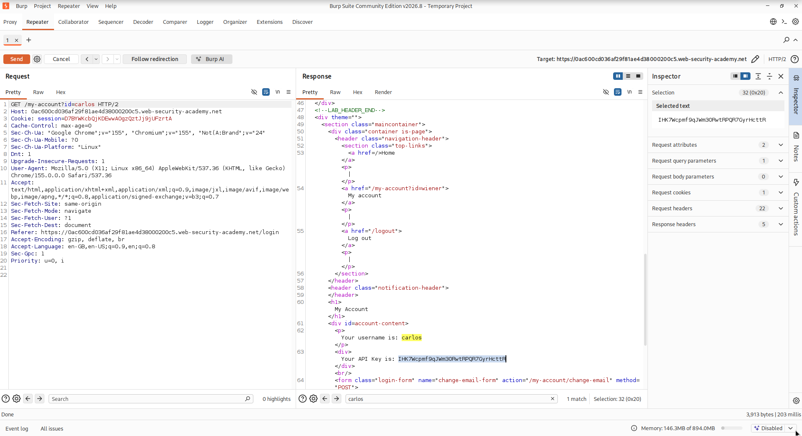
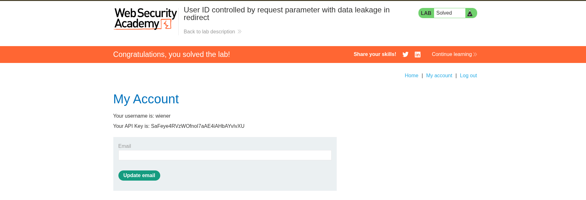

# Lab Name - User ID controlled by request parameter with data leakage in redirect

## Vulnerability

Horizontal Privledged escalation 

## Objective  

change the username Paramater and get the **API KEY**  in redirection  

## Steps

1. Log in using the supplied credentials and access your account page.
2. Send the request to Burp Repeater.
3. Change the "id" parameter to carlos.
4. Observe that although the response is now redirecting you to the home page, it has a body containing the API key belonging to carlos.
5. Submit the API key.

## Result

Successfully accessed the other user account . 

## Key Learning

In this lab , During change the username and redirection show Targeted api key 

proof of concept . 

